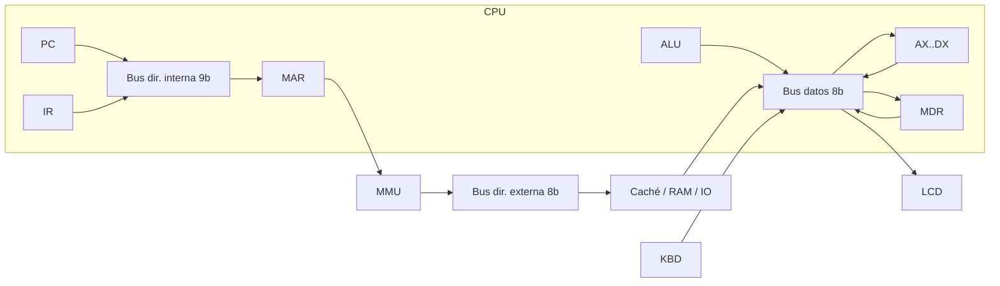
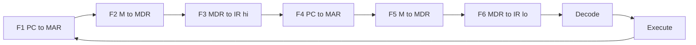

# Byte Bakers — Simulador Avanzado de Computadora

<p align="center">
  
</p>

> 🇬🇧 [English version](README_EN.md)

Simulador de una computadora de 8 bits construido en **Excel + VBA**: CPU con 4 registros de propósito general, buses del sistema con **buffers tri-estado** y alta impedancia (High-Z), palabra de control animada, jerarquía de caché **L1I / L1D / L2**, **memoria virtual paginada** de 512 bytes sobre 256 bytes de RAM, y periféricos mapeados en memoria (**teclado** y **pantalla LCD 8x1**).

**Materia:** Arquitectura de Computadoras (SIS-131) — Universidad Católica Boliviana "San Pablo", Santa Cruz
**Evaluación:** Segundo parcial — Proyecto de ingeniería y sustentación oral

---

## Equipo

| Integrante | Rol | Módulos VBA |
|---|---|---|
| **Adriana** | CPU, buses del sistema e integración | `modConfig`, `modState`, `modISA`, `modCPU`, `modALU`, `modBus`, `modControlWord`, `modControlUnit`, `modPanelCPU` |
| **Karen** | Jerarquía de memoria y herramientas del repositorio | `modDevTools`, `modVMem`, `modMMU`, `modMemory`, `modCache`, `modPanelMemory` |
| **Misael** | Entrada/Salida, software e interfaz | `modUI`, `modDashboard`, `modKeyboard`, `modLCD`, `modIO`, `modAssembler`, `modLoader` |

Tablero Kanban: [GitHub Projects](https://github.com/users/Adriana-HS/projects/4)

---

## Índice

| # | Sección | Responsable | Tarea |
|---|---|---|---|
| 1 | [Descarga y ejecución](#1-descarga-y-ejecución) | Adriana | [#11](https://github.com/Adriana-HS/byte-bakers-simulator/issues/11) |
| 2 | [Arquitectura del CPU](#2-arquitectura-del-cpu) | Adriana | [#10](https://github.com/Adriana-HS/byte-bakers-simulator/issues/10) |
| 3 | [Conjunto de instrucciones (ISA)](#3-conjunto-de-instrucciones-isa) | Adriana | [#10](https://github.com/Adriana-HS/byte-bakers-simulator/issues/10) |
| 4 | [Formato de instrucción](#4-formato-de-instrucción) | Adriana | [#10](https://github.com/Adriana-HS/byte-bakers-simulator/issues/10) |
| 5 | [Buses del sistema y buffers tri-estado](#5-buses-del-sistema-y-buffers-tri-estado) | Adriana | [#10](https://github.com/Adriana-HS/byte-bakers-simulator/issues/10) |
| 6 | [Palabra de control](#6-palabra-de-control) | Adriana | [#10](https://github.com/Adriana-HS/byte-bakers-simulator/issues/10) |
| 7 | [Ciclo de instrucción](#7-ciclo-de-instrucción) | Adriana | [#10](https://github.com/Adriana-HS/byte-bakers-simulator/issues/10) |
| 8 | [Mapa de memoria](#8-mapa-de-memoria) | Karen | [#23](https://github.com/Adriana-HS/byte-bakers-simulator/issues/23) |
| 9 | [Memoria virtual y paginación](#9-memoria-virtual-y-paginación) | Karen | [#23](https://github.com/Adriana-HS/byte-bakers-simulator/issues/23) |
| 10 | [Jerarquía de caché L1I / L1D / L2](#10-jerarquía-de-caché-l1i--l1d--l2) | Karen | [#23](https://github.com/Adriana-HS/byte-bakers-simulator/issues/23) |
| 11 | [Entrada/Salida: teclado y LCD 8x1](#11-entradasalida-teclado-y-lcd-8x1) | Misael | [#33](https://github.com/Adriana-HS/byte-bakers-simulator/issues/33) |
| 12 | [Ensamblador, editor y cargador](#12-ensamblador-editor-y-cargador) | Misael | [#33](https://github.com/Adriana-HS/byte-bakers-simulator/issues/33) |
| 13 | [Manual de usuario](#13-manual-de-usuario) | Misael | [#33](https://github.com/Adriana-HS/byte-bakers-simulator/issues/33) |
| 14 | [Metodología de trabajo](#14-metodología-de-trabajo) | Misael | [#33](https://github.com/Adriana-HS/byte-bakers-simulator/issues/33) |
| 15 | [Estructura del repositorio](#15-estructura-del-repositorio) | Adriana | [#1](https://github.com/Adriana-HS/byte-bakers-simulator/issues/1) |
| 16 | [Cómo contribuir](#16-cómo-contribuir) | Karen | [#12](https://github.com/Adriana-HS/byte-bakers-simulator/issues/12) |

---

## 1. Descarga y ejecución

_Pendiente — enlace público al libro `ByteBakers.xlsm` (release v1.0.0)._

## 2. Arquitectura del CPU

CPU de **8 bits** con cuatro registros de propósito general (**AX, BX, CX, DX**), registros de control (**PC, IR, MAR, MDR, PADDR**) y temporarios de ALU (**TA, TB**). Flags: **ZF** (cero), **CF** (acarreo/préstamo), **SF** (signo, bit 7).

| Bloque | Rol |
|---|---|
| Banco de registros | Lectura/escritura con wrap de 8 bits (`0…255`) |
| ALU | ADD/SUB/INC/DEC/AND/OR/XOR/CMP sobre TA/TB; actualiza flags según la ISA |
| Unidad de control | Micro-pasos: fetch F1–F6, decode, execute; un clic = un micro-paso |
| Buses | Dirección interna 9 bits, dirección externa 8 bits, datos 8 bits, High-Z |
| Palabra de control | 27 señales `En_*` / `Ld_*` / Mem / IO + pulso CLK |

Detalle de la hoja `ISA` y del panel Simulator: módulos `modISA`, `modPanelCPU`, `modControlUnit`.

## 3. Conjunto de instrucciones (ISA)

Fuente de verdad: [`src/modISA.bas`](src/modISA.bas) y [`docs/ISA.md`](docs/ISA.md). Resumen:

| Opcode | Mnemonic | Formato | Flags | Descripción |
|---|---|---|---|---|
| `0x00` | NOP | — | - | No hace nada |
| `0x01` | MOV | RI | - | r ← imm |
| `0x02` | MOV | RR | - | r ← r2 |
| `0x03` | LOAD | RM | - | r ← M[addr] |
| `0x04` | STORE | MR | - | M[addr] ← r |
| `0x05`/`0x06` | ADD | RR / RI | Z C S | r ← r + op |
| `0x07`/`0x08` | SUB | RR / RI | Z C S | r ← r − op |
| `0x09`/`0x0A` | INC / DEC | R | Z S | r ← r ± 1 |
| `0x0B`/`0x0C` | CMP | RR / RI | Z C S | resta solo flags |
| `0x0D`–`0x0F` | AND / OR / XOR | RR | Z S | lógica bit a bit |
| `0x10`–`0x14` | JMP / JZ / JNZ / JC / JS | A | - | saltos (condicionales usan flags) |
| `0x15` / `0x16` | IN / OUT | RK / LR | - | teclado / LCD |
| `0x1F` | HLT | — | - | detiene Run |

## 4. Formato de instrucción

Instrucción fija de **2 bytes**:

```
Byte 0: [ opcode: 5 | reg: 2 | A8: 1 ]
Byte 1: [ operand: 8 ]
```

- **reg** = destino (origen en STORE/OUT).
- **A8 + operand** = dirección virtual de 9 bits (`0x000`–`0x1FF`) o inmediato 0–255.
- En formatos RR el operando bajo lleva el registro fuente en los 2 bits bajos.

## 5. Buses del sistema y buffers tri-estado

| Bus | Ancho | Quién conduce | Uso |
|---|---|---|---|
| Dirección **interna** | 9 bits | PC o campo addr de IR (`En_PC` / `En_IR_A`) | PC/IR → MAR (virtual) |
| Dirección **externa** | 8 bits | MMU (PADDR) | acceso a caché / RAM / I/O |
| Datos | 8 bits | un solo `En_*` a la vez | regs ↔ MDR ↔ memoria / KBD / LCD |
| Control | 27 bits + CLK | Unidad de control | señales del micro-paso |

Sin conductor activo el bus vale **High-Z** (`-1`) y el buffer se pinta gris. Un segundo conductor en el mismo micro-paso lanza *Bus collision*.



## 6. Palabra de control

27 señales (bit 0 = `En_PC` … bit 26 = `En_IR_D`). Tabla completa en la hoja `ISA` (generada por `PaintControlWordOnISA`) y en `modControlWord`.

**Reglas de validación** (cada micro-paso, `ValidateControlWord`):

1. Como máximo **un** conductor de datos: entre `En_MDR`, `En_IR_D`, `En_AX`…`En_DX`, `En_ALU`, `En_KBD`.
2. Como máximo **un** conductor de dirección: entre `En_PC`, `En_IR_A`.
3. Como máximo **un** acceso externo: `Mem_R + Mem_W + IO_R + IO_W ≤ 1`.

Varios `Ld_*` pueden estar activos a la vez (varios receptores del mismo valor).

## 7. Ciclo de instrucción



- **STEP** = un micro-paso (`StepMicro`).
- **RUN** = bucle a la velocidad del slider hasta **HLT** o Pause.
- Cada micro-paso escribe una fila en la hoja **Log** (reloj, palabra de control, transferencia).

## 8. Mapa de memoria

_Pendiente._

## 9. Memoria virtual y paginación

_Pendiente._

## 10. Jerarquía de caché L1I / L1D / L2

_Pendiente._

## 11. Entrada/Salida: teclado y LCD 8x1

_Pendiente._

## 12. Ensamblador, editor y cargador

_Pendiente._

## 13. Manual de usuario

_Pendiente._

## 14. Metodología de trabajo

_Pendiente — Gitflow, tablero Kanban, convención de commits y reparto de tareas._

## 15. Estructura del repositorio

```
byte-bakers-simulator/
├── src/            módulos VBA exportados (.bas)
├── excel/          libro ByteBakers.xlsm
├── programs/       programas del catálogo (.asm)
├── docs/
│   ├── img/        capturas y diagramas
│   ├── logo/       logo en PNG y SVG
│   └── slides/     presentación de la defensa (PDF)
├── .github/        plantillas de issues y pull requests
├── README.md       documentación en español
└── README_EN.md    documentación en inglés
```

## 16. Cómo contribuir

### Configuración inicial (una sola vez)

1. Clona el repositorio y abre SIEMPRE `excel/ByteBakers.xlsm` desde la carpeta `excel/` del repo (nunca una copia en otra carpeta).
2. En Excel: Archivo → Opciones → Centro de confianza → Configuración del Centro de confianza → Configuración de macros → activa **Confiar en el acceso al modelo de objetos de proyectos de VBA**.
3. Configura Git con tu nombre y el correo registrado en tu cuenta de GitHub:
   `git config user.name "Tu Nombre"` y `git config user.email "tu@correo.com"`.
4. Abre el editor de VBA (Alt + F11) y ejecuta **ImportModules** (Alt + F8) para traer a tu libro el código de `src/`.

### Flujo diario

1. `git checkout develop && git pull`
2. Crea tu rama: `git checkout -b feature/<tu-nombre>/<modulo>-<tema>`
3. Abre Excel y ejecuta la macro **ImportModules** (trae el código más reciente de todos desde `src/`).
4. Programa solo tus módulos.
5. Ejecuta la macro **ExportModules** (escribe los módulos en `src/`).
6. `git add src/<tu-modulo>.bas` → `git commit -m "feat(modulo): descripcion (#issue)"` → `git push`
7. Abre un Pull Request hacia `develop` con descripción, cómo probar, captura y `Closes #n`.

### Reglas

- Nunca se hace commit del `.xlsm` (solo quien integra).
- Nadie hace commit directo a `main` ni a `develop`.
- Una tarea = un issue = una rama = un PR. Merge con "Create a merge commit" (no squash).
- Al implementar una función, bórrala del módulo `modStubs_<nombre>` en el mismo PR.
- Al pegar código en el editor VBA: Insertar → Módulo, renombra con F4 y NO pegues la línea `Attribute VB_Name`.
- Haz `git add` solo de tus archivos (nunca `git add .`): al exportar, Excel reescribe también los módulos de los demás con diferencias cosméticas (por ejemplo, quita el `&` final de las constantes hexadecimales). Si aparecen modificados, restáuralos con `git restore src/<modulo>.bas`.