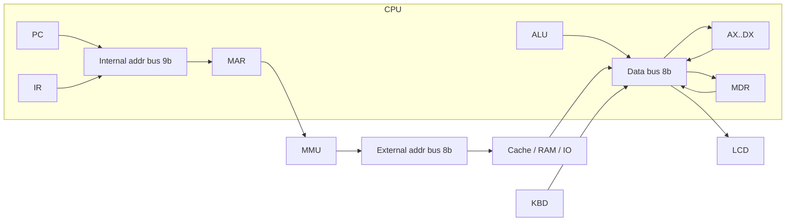
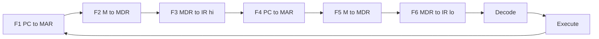

# Byte Bakers — Advanced Computer Simulator

<p align="center">
  
</p>

> 🇪🇸 [Versión en español](README.md)

An 8-bit computer simulator built in **Excel + VBA**: a CPU with 4 general-purpose registers, system buses with **tri-state buffers** and high impedance (High-Z), an animated control word, an **L1I / L1D / L2** cache hierarchy, 512 bytes of **paged virtual memory** on top of 256 bytes of RAM, and memory-mapped peripherals (**keyboard** and **8x1 LCD**).

**Course:** Computer Architecture (SIS-131) — Universidad Católica Boliviana "San Pablo", Santa Cruz
**Assessment:** Second midterm — Engineering project and oral defense

---

## Team

| Member | Role | VBA modules |
|---|---|---|
| **Adriana** | CPU, system buses and integration | `modConfig`, `modState`, `modISA`, `modCPU`, `modALU`, `modBus`, `modControlWord`, `modControlUnit`, `modPanelCPU` |
| **Karen** | Memory hierarchy and repository tooling | `modDevTools`, `modVMem`, `modMMU`, `modMemory`, `modCache`, `modPanelMemory` |
| **Misael** | Input/Output, software and user interface | `modUI`, `modDashboard`, `modKeyboard`, `modLCD`, `modIO`, `modAssembler`, `modLoader` |

Kanban board: [GitHub Projects](https://github.com/users/Adriana-HS/projects/4)

---

## Contents

| # | Section | Owner | Task |
|---|---|---|---|
| 1 | [Download and run](#1-download-and-run) | Adriana | [#11](https://github.com/Adriana-HS/byte-bakers-simulator/issues/11) |
| 2 | [CPU architecture](#2-cpu-architecture) | Adriana | [#10](https://github.com/Adriana-HS/byte-bakers-simulator/issues/10) |
| 3 | [Instruction set (ISA)](#3-instruction-set-isa) | Adriana | [#10](https://github.com/Adriana-HS/byte-bakers-simulator/issues/10) |
| 4 | [Instruction format](#4-instruction-format) | Adriana | [#10](https://github.com/Adriana-HS/byte-bakers-simulator/issues/10) |
| 5 | [System buses and tri-state buffers](#5-system-buses-and-tri-state-buffers) | Adriana | [#10](https://github.com/Adriana-HS/byte-bakers-simulator/issues/10) |
| 6 | [Control word](#6-control-word) | Adriana | [#10](https://github.com/Adriana-HS/byte-bakers-simulator/issues/10) |
| 7 | [Instruction cycle](#7-instruction-cycle) | Adriana | [#10](https://github.com/Adriana-HS/byte-bakers-simulator/issues/10) |
| 8 | [Memory map](#8-memory-map) | Karen | [#23](https://github.com/Adriana-HS/byte-bakers-simulator/issues/23) |
| 9 | [Virtual memory and paging](#9-virtual-memory-and-paging) | Karen | [#23](https://github.com/Adriana-HS/byte-bakers-simulator/issues/23) |
| 10 | [L1I / L1D / L2 cache hierarchy](#10-l1i--l1d--l2-cache-hierarchy) | Karen | [#23](https://github.com/Adriana-HS/byte-bakers-simulator/issues/23) |
| 11 | [Input/Output: keyboard and 8x1 LCD](#11-inputoutput-keyboard-and-8x1-lcd) | Misael | [#33](https://github.com/Adriana-HS/byte-bakers-simulator/issues/33) |
| 12 | [Assembler, editor and loader](#12-assembler-editor-and-loader) | Misael | [#33](https://github.com/Adriana-HS/byte-bakers-simulator/issues/33) |
| 13 | [User manual](#13-user-manual) | Misael | [#33](https://github.com/Adriana-HS/byte-bakers-simulator/issues/33) |
| 14 | [Methodology](#14-methodology) | Misael | [#33](https://github.com/Adriana-HS/byte-bakers-simulator/issues/33) |
| 15 | [Repository layout](#15-repository-layout) | Adriana | [#1](https://github.com/Adriana-HS/byte-bakers-simulator/issues/1) |
| 16 | [Contributing](#16-contributing) | Karen | [#12](https://github.com/Adriana-HS/byte-bakers-simulator/issues/12) |

---

## 1. Download and run

_Pending — public link to the `ByteBakers.xlsm` workbook (release v1.0.0)._

## 2. CPU architecture

An **8-bit** CPU with four general-purpose registers (**AX, BX, CX, DX**), control registers (**PC, IR, MAR, MDR, PADDR**), and ALU temporaries (**TA, TB**). Flags: **ZF** (zero), **CF** (carry/borrow), **SF** (sign, bit 7).

| Block | Role |
|---|---|
| Register file | Read/write with 8-bit wrap (`0…255`) |
| ALU | ADD/SUB/INC/DEC/AND/OR/XOR/CMP on TA/TB; updates flags per the ISA |
| Control unit | Micro-steps: fetch F1–F6, decode, execute; one click = one micro-step |
| Buses | 9-bit internal address, 8-bit external address, 8-bit data, High-Z |
| Control word | 27 `En_*` / `Ld_*` / Mem / IO signals plus the CLK pulse |

See also the workbook `ISA` sheet and Simulator panel (`modISA`, `modPanelCPU`, `modControlUnit`).

## 3. Instruction set (ISA)

Source of truth: [`src/modISA.bas`](src/modISA.bas) and [`docs/ISA.md`](docs/ISA.md). Summary:

| Opcode | Mnemonic | Format | Flags | Description |
|---|---|---|---|---|
| `0x00` | NOP | — | - | No operation |
| `0x01` | MOV | RI | - | r ← imm |
| `0x02` | MOV | RR | - | r ← r2 |
| `0x03` | LOAD | RM | - | r ← M[addr] |
| `0x04` | STORE | MR | - | M[addr] ← r |
| `0x05`/`0x06` | ADD | RR / RI | Z C S | r ← r + op |
| `0x07`/`0x08` | SUB | RR / RI | Z C S | r ← r − op |
| `0x09`/`0x0A` | INC / DEC | R | Z S | r ← r ± 1 |
| `0x0B`/`0x0C` | CMP | RR / RI | Z C S | subtract for flags only |
| `0x0D`–`0x0F` | AND / OR / XOR | RR | Z S | bitwise logic |
| `0x10`–`0x14` | JMP / JZ / JNZ / JC / JS | A | - | jumps (conditionals use flags) |
| `0x15` / `0x16` | IN / OUT | RK / LR | - | keyboard / LCD |
| `0x1F` | HLT | — | - | stops Run |

## 4. Instruction format

Fixed **2-byte** instruction:

```
Byte 0: [ opcode: 5 | reg: 2 | A8: 1 ]
Byte 1: [ operand: 8 ]
```

- **reg** is the destination (source for STORE/OUT).
- **A8 + operand** forms a 9-bit virtual address (`0x000`–`0x1FF`) or an immediate 0–255.
- In RR formats the low operand carries the source register in its bottom two bits.

## 5. System buses and tri-state buffers

| Bus | Width | Driver | Use |
|---|---|---|---|
| **Internal** address | 9 bits | PC or IR address field (`En_PC` / `En_IR_A`) | PC/IR → MAR (virtual) |
| **External** address | 8 bits | MMU (PADDR) | cache / RAM / I/O access |
| Data | 8 bits | exactly one `En_*` | regs ↔ MDR ↔ memory / KBD / LCD |
| Control | 27 bits + CLK | Control unit | current micro-step signals |

With no driver the bus holds **High-Z** (`-1`) and the buffer is painted gray. A second driver in the same micro-step raises *Bus collision*.



## 6. Control word

27 signals (bit 0 = `En_PC` … bit 26 = `En_IR_D`). Full table on the `ISA` sheet (`PaintControlWordOnISA`) and in `modControlWord`.

**Validation rules** (every micro-step, `ValidateControlWord`):

1. At most **one** data-bus driver among `En_MDR`, `En_IR_D`, `En_AX`…`En_DX`, `En_ALU`, `En_KBD`.
2. At most **one** address-bus driver among `En_PC`, `En_IR_A`.
3. At most **one** external access: `Mem_R + Mem_W + IO_R + IO_W ≤ 1`.

Several `Ld_*` loads may be active together (multiple receivers of the same value).

## 7. Instruction cycle



- **STEP** runs a single micro-step (`StepMicro`).
- **RUN** loops at the slider speed until **HLT** or Pause.
- Every micro-step appends a row on the **Log** sheet (clock, control word, transfer).

## 8. Memory map

_Pending._

## 9. Virtual memory and paging

_Pending._

## 10. L1I / L1D / L2 cache hierarchy

_Pending._

## 11. Input/Output: keyboard and 8x1 LCD

_Pending._

## 12. Assembler, editor and loader

_Pending._

## 13. User manual

_Pending._

## 14. Methodology

_Pending — Gitflow, Kanban board, commit convention and task split._

## 15. Repository layout

```
byte-bakers-simulator/
├── src/            exported VBA modules (.bas)
├── excel/          ByteBakers.xlsm workbook
├── programs/       catalog programs (.asm)
├── docs/
│   ├── img/        screenshots and diagrams
│   ├── logo/       logo in PNG and SVG
│   └── slides/     defense slide deck (PDF)
├── .github/        issue and pull request templates
├── README.md       Spanish documentation
└── README_EN.md    English documentation
```

## 16. Contributing

### One-time setup

1. Clone the repo and ALWAYS open `excel/ByteBakers.xlsm` from the repo's `excel/` folder (never a copy elsewhere).
2. In Excel: File → Options → Trust Center → Trust Center Settings → Macro Settings → enable **Trust access to the VBA project object model**.
3. Set Git `user.name` and the `user.email` registered on your GitHub account:
   `git config user.name "Your Name"` and `git config user.email "you@email.com"`.
4. Open the VBA editor (Alt + F11) and run **ImportModules** (Alt + F8) to load the code from `src/` into your workbook.

### Daily workflow

1. `git checkout develop && git pull`
2. Create your branch: `git checkout -b feature/<your-name>/<module>-<topic>`
3. Open Excel and run the **ImportModules** macro (loads everyone's latest code from `src/`).
4. Work only on your own modules.
5. Run the **ExportModules** macro (writes the modules to `src/`).
6. `git add src/<your-module>.bas` → `git commit -m "feat(module): description (#issue)"` → `git push`
7. Open a Pull Request into `develop` with a description, how to test, a screenshot and `Closes #n`.

### Rules

- Never commit the `.xlsm` (only the integrator does).
- No direct commits to `main` or `develop`.
- One task = one issue = one branch = one PR. Merge with "Create a merge commit" (no squash).
- When you implement a function, delete it from `modStubs_<name>` in the same PR.
- When pasting code into the VBA editor: Insert → Module, rename with F4, and do NOT paste the `Attribute VB_Name` line.
- Only `git add` your own files (never `git add .`): when exporting, Excel also rewrites other people's modules with cosmetic differences (for example, it drops the trailing `&` from hexadecimal constants). If they show up as modified, restore them with `git restore src/<module>.bas`.